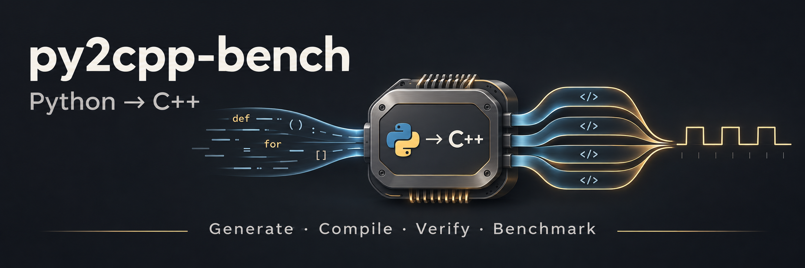

# Python → C++ Bench

[](https://github.com/SeeBurtOh/py2cpp-bench/actions/workflows/tests.yml)


**Which model can turn your Python into the fastest correct C++?**

Give each model the same program and **one attempt**. Compile its answer on your machine,
check it against Python, and rank correct candidates by measured speedup. Models are free
to change algorithms, use multiple cores, and use native SIMD.

**Local execution · Your API keys · No repair rounds · Inspectable results**

## Try it without API keys

You need **Python 3.11+** and **Clang with C++23 support**. macOS is the supported native
sandbox target; install developer tools with `xcode-select --install` if needed.

```bash
git clone https://github.com/SeeBurtOh/py2cpp-bench.git
cd py2cpp-bench
python3 -m py2cpp_bench doctor
python3 -m py2cpp_bench run --demo --iterations 1000000
```

The demo uses handwritten C++, makes no API calls, and needs no Python packages.
Omit `--iterations` to run the full **200-million-iteration pi example**.

## Bring in the models

Install the CLI with optional keychain support, then follow the guided setup:

```bash
python3 -m venv .venv
source .venv/bin/activate
python -m pip install '.[keychain]'
py2cpp-bench setup
```

Setup offers **OS-keychain storage**, **private entry per run**, or **environment variables**.
Follow its suggested run command, or use `py2cpp-bench run` once credentials are saved.
Key entry is hidden; setup makes no API calls. A live run sends your source to the selected
providers and uses your API credits. [Key setup and removal →](docs/guide.md#bring-your-own-keys)

| Provider | Default model | Environment variable |
| --- | --- | --- |
| OpenAI | `gpt-6.1-sol` | `OPENAI_API_KEY` |
| Anthropic | `claude-sonnet-5-5` | `ANTHROPIC_API_KEY` |
| xAI | `grok-4.3` | `XAI_API_KEY` |
| Google | `gemini-4-argon` | `GEMINI_API_KEY` |

Model IDs are configurable; availability depends on the provider and your account.
Missing credentials and unavailable models are reported, never silently substituted.

To select a model and enter a key without saving it:

```bash
py2cpp-bench run --model openai:YOUR_MODEL_ID --ask-keys
```

## What gets measured?

**Python baseline → one C++ rewrite per model → compile → verify → three timed runs**

The pi example checks additional runtime inputs, not just one fixed answer. Only candidates
that match every checked output are ranked. Speedup is **best Python wall time ÷ best C++
wall time**; median times, failures, source, and diagnostics are saved under `runs/`.

An actual **offline demo** on Apple M4, Python 3.15, and Apple Clang 21:

| Implementation | Printed result | Best wall time | Speedup |
| --- | --- | --- | --- |
| Original Python | `3.141592656089` | 10.666 s | 1.00× |
| Handwritten serial C++ | `3.141592656089` | 0.221 s | **48.24×** |

This is a demonstration of the benchmark pipeline, **not an AI leaderboard**. Your results
will vary. Timings include process startup; generation and compilation are measured separately.
[Methodology and compiler options →](docs/guide.md#benchmark-rules)

## Try your own program

Start with a standalone, deterministic Python script that takes command-line arguments and
prints results. Supply extra cases to check the rewrite:

```bash
py2cpp-bench run ./my_program.py \
  --arg 1000000 --check-args '["10"]' --check-args '["12345"]' \
  --model openai:YOUR_MODEL_ID
```

This is an **experimental optimization tool**, not a general Python compiler. Local imports,
data files, interactive input, and project migration are outside the initial scope.
[Custom programs →](docs/guide.md#use-another-python-program)

## A few useful details

- **Preview first:** `py2cpp-bench run --dry-run` saves prompts without calling models.
- **Credentials:** generated programs never inherit API keys in their environment.
- **Isolation:** macOS blocks network and unrelated-file access. Linux needs a disposable VM
  and explicit `--isolation none`; the runner is not a hardened hostile-code service.
- **Validation:** automated tests mock provider APIs and keychain reads/writes; live access
  still needs verification with your own accounts.

[Full guide](docs/guide.md) · [Execution safety](docs/guide.md#execution-boundary) ·
[Reports](docs/guide.md#artifacts-and-exit-status) · [Development](docs/guide.md#development)
